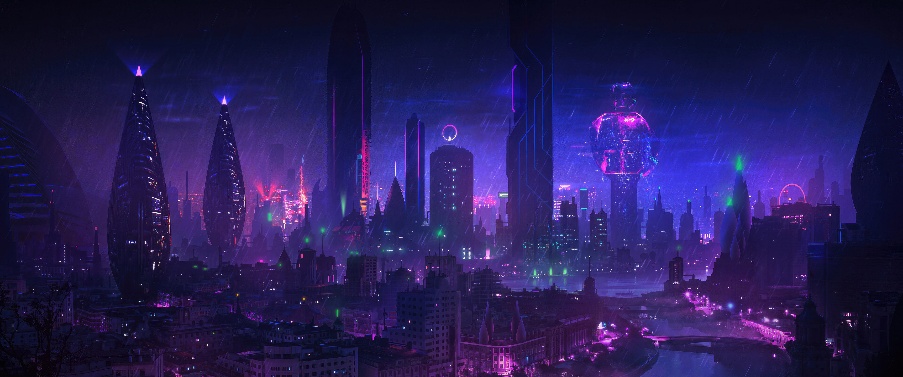

**aspiring developer**

*Exploring technology, design and creative ideas.*

---

### 01 / about me

I'm an aspiring developer interested in technology, web development and design.

I enjoy learning new skills, exploring creative ideas and building digital experiences.

- Currently learning web development.
- Interested in web design and UI/UX.
- Into music, languages and creative projects.
- Always curious, always learning.

### 02 / technologies

### 03 / selected projects

**SONORA** `✦ featured`

A creative music experience focused on music discovery and interaction.

[Explore repository →](https://github.com/Mackycky/SONORA)

**PINKterest**

A Pinterest-inspired visual gallery exploring different pink aesthetics and styles.

[Explore repository →](https://github.com/Mackycky/PINKTEREST)

---

### 04 / github stats

`✦` Thanks for visiting my profile. `♡`

